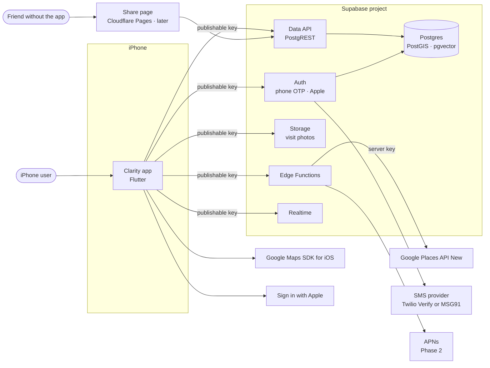
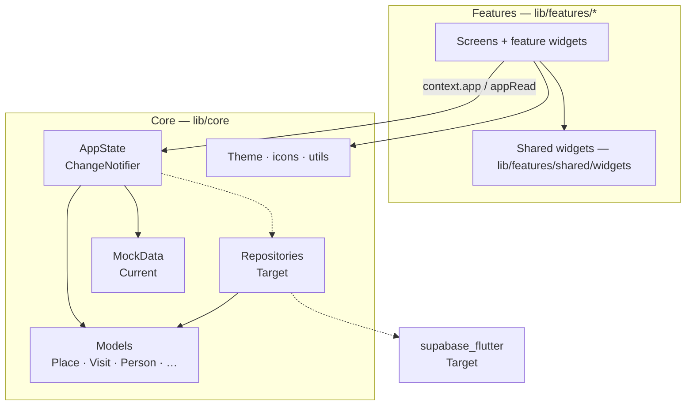
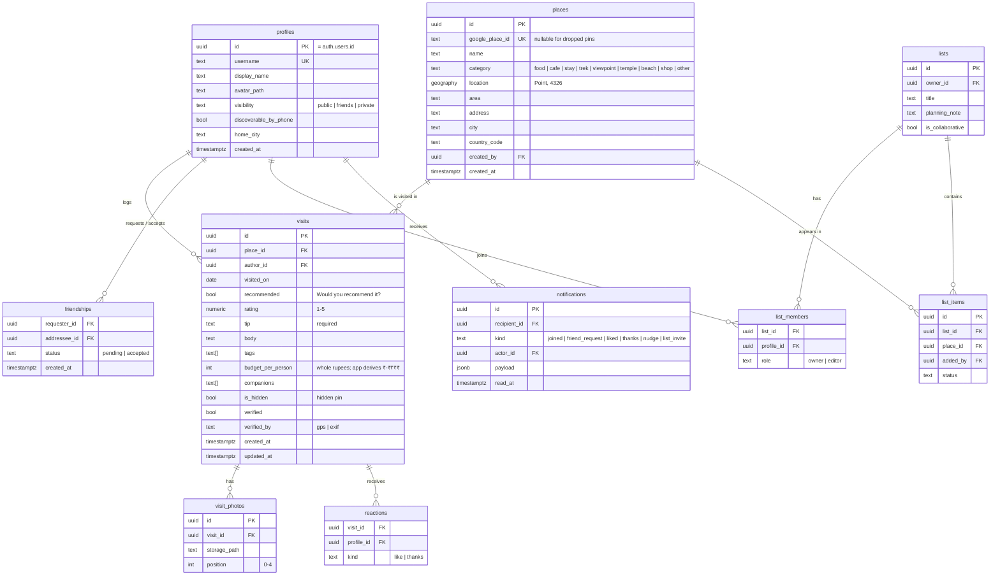
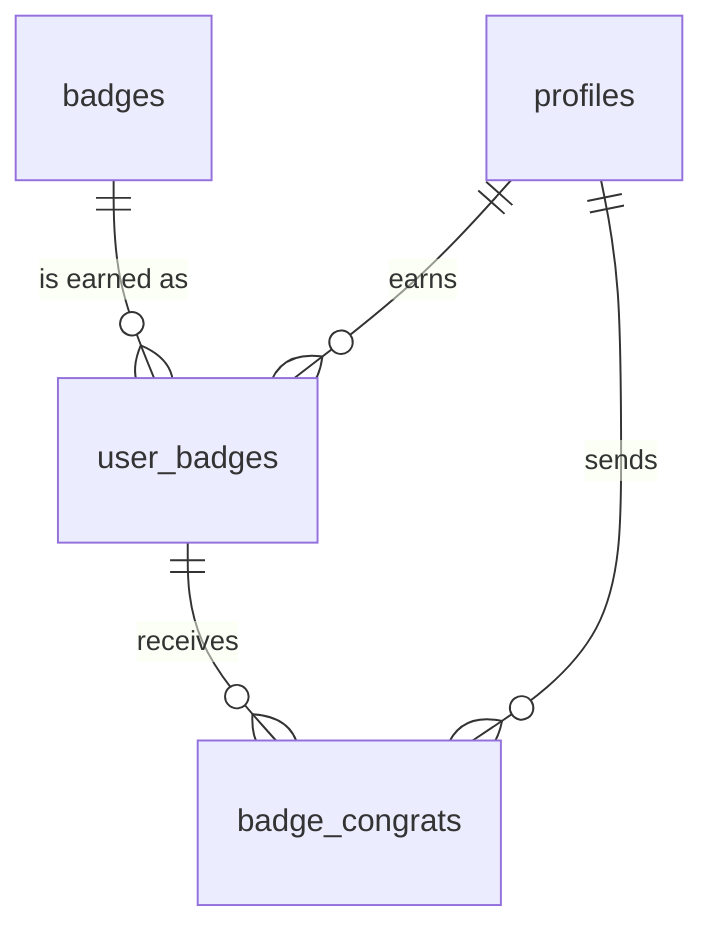
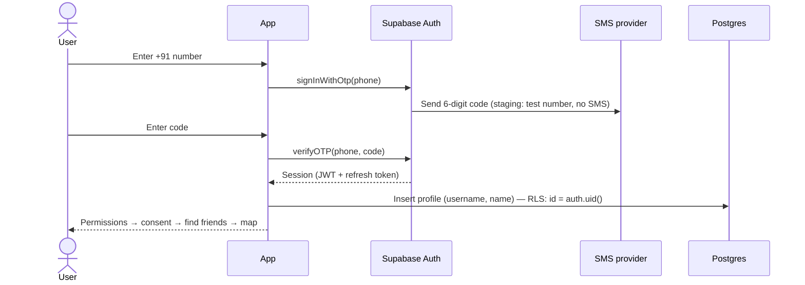
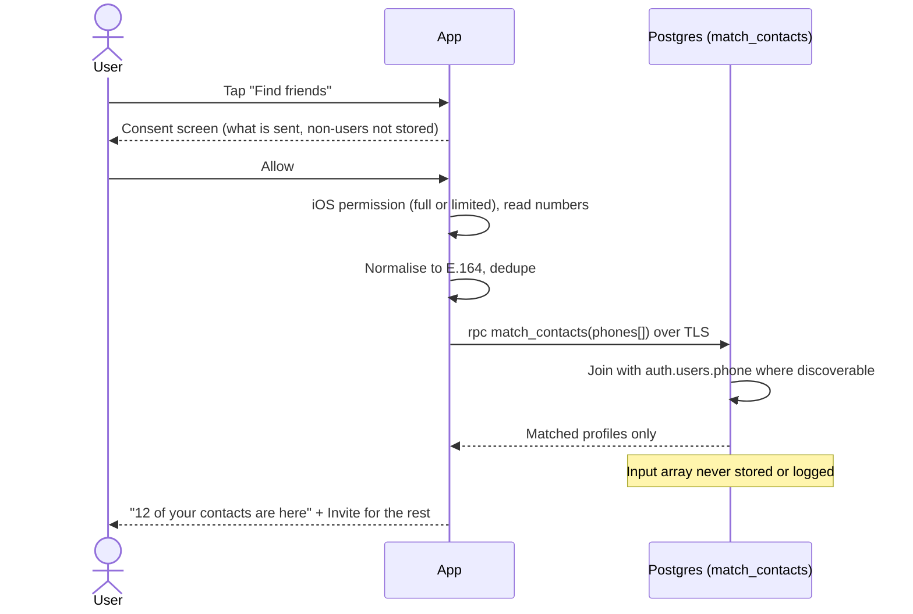
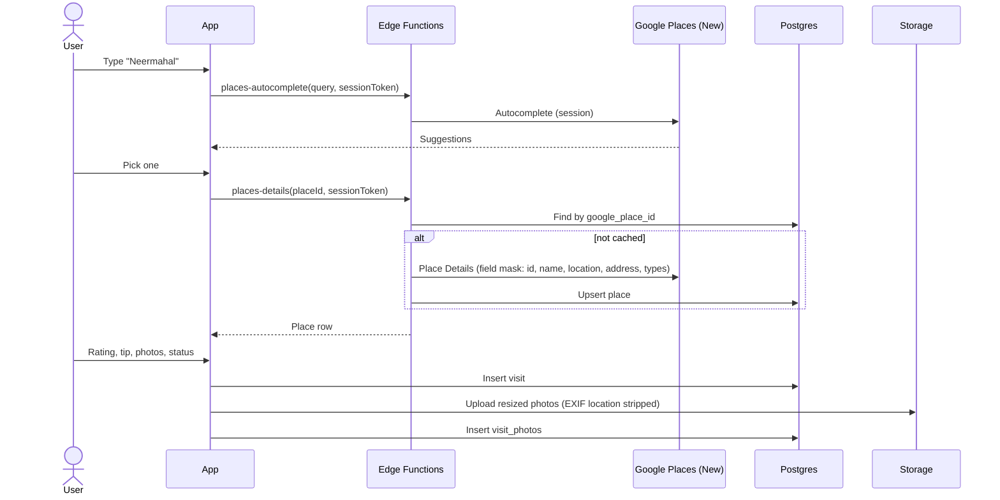

# Clarity — Architecture

| | |
| --- | --- |
| **Scope** | iPhone app (Flutter), Supabase backend, third-party services, delivery pipeline |
| **Status** | Client built on mock data · backend designed, not yet wired |
| **Last updated** | 2026-10-10 |
| **Related** | [`PRD.md`](./PRD.md) · [`DESIGN_SYSTEM.md`](./DESIGN_SYSTEM.md) · [`../AGENTS.md`](../AGENTS.md) (coding rules) · [`../CONTRIBUTING.md`](../CONTRIBUTING.md) (git flow) |

Sections marked **Current** describe code that exists today. Sections marked
**Target** describe the design we are building towards; update them to Current
as each piece lands.

---

## 1. Principles

1. **₹0 until real users.** Free tiers everywhere; paid services only when a
   feature needs them and users exist.
2. **Privacy by construction.** Row-level security on every table, only public
   keys in the app, non-users' contact data never stored.
3. **Place ≠ Visit.** A place is shared and holds no opinions; a visit is one
   person's experience of it. This split is non-negotiable.
4. **Thin client, smart database.** Business rules (visibility, matching,
   nearby search) live in Postgres functions and policies, so Android and the
   web share page get them for free.
5. **Incremental.** Each integration lands as its own PR into `staging`; the app
   stays runnable on mock data until a step replaces it.
6. **One codebase.** Flutter for iOS now, Android in Phase 3.

## 2. System context



## 3. Technology stack

| Layer | Choice | Status |
| --- | --- | --- |
| App | Flutter 3.47.7 / Dart 3.13, iPhone first | **Current** |
| UI | Custom design system (`AppColors`, `AppText`, shared widgets), Manrope + Newsreader | **Current** |
| State | One `AppState` (`ChangeNotifier`) exposed by `AppScope` (`InheritedNotifier`) | **Current** |
| Navigation | Named routes (`Routes.*`, `onGenerateRoute`) | **Current** |
| Backend | Supabase: Postgres, Auth, Storage, Edge Functions (Deno), Realtime | Target |
| Client SDK | `supabase_flutter` (publishable key) | Target |
| Geo | PostGIS (`geography(Point)`, GiST index) | Target |
| Map display | `google_maps_flutter` (Maps SDK for iOS) | Target |
| Place search | Google Places API (New), called only from Edge Functions | Target |
| Auth | Phone OTP (Supabase Auth + SMS provider), Sign in with Apple (`sign_in_with_apple`) | Target |
| Contacts | `flutter_contacts` | Target |
| Location | `geolocator` | Target |
| Photos | `image_picker`, client-side resize, Supabase Storage | Target |
| Push | APNs (via FCM or direct) | Phase 2 |
| Share page | Small static site on Cloudflare Pages | Phase 1 (late) |
| Semantic search | pgvector + Supabase's built-in embedding model | Phase 3 |
| CI/CD | GitHub Actions, git hooks, GitHub rulesets | **Current** |

## 4. Client architecture

### 4.1 Layers



- **Screens** read state with `context.app` (subscribes) and call actions with
  `context.appRead` (no subscription). They never hold their own copy of mutable
  app data.
- **AppState** (Current) owns session, profile, places, visits, friends,
  requests, feed status, notifications and the selected tab. Its public API is
  the contract the UI depends on.
- **Backend** (Current) sits behind `AppState`: `Backend` interface with
  `SupabaseBackend` and `MockBackend` (`lib/core/data/`). `AppState` loads an
  `AppSnapshot` after sign-in and writes optimistically, then in the background.
  Splitting it into per-domain repositories is the next step if it grows:
  originally planned as one repository per domain:
  `AuthRepository`, `ProfileRepository`, `PlaceRepository`, `VisitRepository`,
  `FriendRepository`, `FeedRepository`, `ListRepository`,
  `NotificationRepository`, `ContactsRepository`. Each has a Supabase
  implementation and a mock implementation built from `MockData`, so tests and
  the "Design states" sheet keep working without a network.
- **Models** are immutable, `const`-constructible value classes. Repositories
  map database rows to them; the UI never sees raw JSON.

**Migration path:** replace `MockData` reads inside `AppState` with repository
calls one feature at a time. `AppState` grows async loading/error states per
feature (the feed already has `FeedStatus`). If `AppState` becomes too large,
split it into per-feature notifiers under the same `AppScope` pattern — no
state-management library is planned.

### 4.2 Folder structure (Current)

```
lib/
  main.dart                    # runApp(ClarityApp)
  app/
    clarity_app.dart           # MaterialApp + AppScope
    routes.dart                # Routes.* + onGenerateRoute
  core/
    theme/                     # AppColors, AppGradients, AppShadows, AppText, AppTheme
    icons/app_icons.dart       # AppIcon (design SVG icons)
    models/                    # place, visit, person, place_category, social
    data/mock_data.dart        # dummy data
    state/app_state.dart       # AppState, AppScope, context.app / appRead
    utils/                     # Fmt (formatters), Layout (design → device)
  features/<feature>/          # one folder per feature, widgets/ for its own widgets
  features/shared/widgets/     # reused components + app_shell.dart
```

**Target additions:** `lib/core/config/env.dart` (typed access to
`--dart-define` values), `lib/core/data/repositories/` (interfaces),
`lib/core/data/supabase/` (implementations), `lib/core/services/`
(contacts, location, photo processing).

### 4.3 Navigation

All full-screen pages are named routes in `lib/app/routes.dart`, with ids (or
small `*Args` classes) as arguments. The tab shell (`AppShell` +
`FloatingNavBar`) hosts four tabs — Map, Feed, Friends, Profile — with **Add**
as an action. Target: an auth gate at `Routes.splash` that routes to onboarding
or `/home` based on the Supabase session; Universal Links (`app_links`) mapped
onto the same routes.

### 4.4 Design system

Full spec: [`DESIGN_SYSTEM.md`](./DESIGN_SYSTEM.md).

- Colours only from `AppColors` / `AppGradients`, shadows from `AppShadows`,
  type from `AppText`, icons from `AppIcon`.
- Layout uses the design's 390×844 coordinates via `Layout.y()` and
  `SheetScaffold(sheetTop:)`, adjusted for each device's safe area.
- Reusable components (`SheetScaffold`, `PrimaryButton`, `TagChip`,
  `RatingBadge`, `MapPinMarker`, …) are listed in `AGENTS.md` §5.

### 4.5 Client-side concerns

| Concern | Approach |
| --- | --- |
| Loading / error / empty | Every data screen renders all three; designs exist (23a–c, 24a–c). |
| Offline | Phase 1: offline banner and cached last-fetched data. Phase 2: local cache (e.g. SQLite) with a write queue. |
| Images | Resize to ≤ 2048 px, JPEG ~80%, strip EXIF location before upload; read EXIF on device first for verification. |
| Permissions | Requested at point of use, each after an in-app explainer screen. |

## 5. Backend architecture (Current — staging)

> **As built (2026-10-10).** The schema lives in `supabase/schemas/` (source of
> truth) and ships as migrations: `20261010120000_initial_schema.sql`, then
> `20261010163000_review_recommend_and_budget.sql` (recommend flag, budget per
> person, custom tags), then `20261012120000_badges.sql` and
> `20261013120000_badges_feed_thanks_festivals.sql` (badges, §5.6).
> Tables: `profiles`, `friendships`, `places`, `visits`, `visit_photos`,
> `saved_places`, `lists`, `list_members`, `list_items`, `list_item_votes`,
> `asks`, `ask_replies`, `likes`, `visit_thanks`, `notifications`, `badges`,
> `user_badges`, `badge_congrats`, `festivals`; bucket `visit-photos`.
> Functions: `get_feed`, `profile_summaries`, `nearby_places`, `match_contacts`,
> `is_username_available`, `delete_my_account`, `my_badges`,
> `mark_badges_seen`, `record_map_shared`; helpers in `private`.
> Verified by 57 pgTAP checks (`make db-test`) and an app ↔ Supabase
> integration test (`make test-integration`). Workflow: `supabase/README.md`.
> Where the diagram below differs (e.g. `reactions` became `likes`), the schema
> files win.

### 5.1 Environments

| Environment | Supabase project | Git branch | Notes |
| --- | --- | --- | --- |
| Dev | `clarity-staging` | `feature/*` (local runs) | Simulator points at staging |
| Staging | `clarity-staging` | `staging` | Test phone numbers; migrations deploy here first |
| Production | `clarity-prod` *(created before launch)* | `main` | Real SMS; Pro plan |

One project now; the prod project is recreated from the same migrations with
`supabase db push`. Region: **Mumbai (ap-south-1)**.

### 5.2 Data model



**Notes**

- The user's phone number stays in `auth.users.phone` (verified by OTP). It is
  never copied into `profiles` and never exposed through the Data API.
- `places` is shared and deduplicated by `google_place_id`. Dropped pins have
  no Google ID and belong to their creator until someone else visits them.
- A revisit is a new `visits` row; nothing is overwritten.
- The feed is a SQL view/function over friends' `visits`, `lists` and asks
  (asks get their own table in Phase 2), ordered by time — no ranking.
- Friend rating, "who's been here" and stats are SQL functions, not stored
  columns.

### 5.3 Access control (row-level security)

Every table has RLS enabled before any data goes in. Because new Supabase
projects no longer expose tables to the Data API automatically, each migration
also contains the explicit `grant` statements for `authenticated` (and `anon`
only where the share page needs it).

| Table | Read | Write |
| --- | --- | --- |
| `profiles` | Self; others per `visibility` (public: everyone · friends: accepted friends · private: nobody) | Self only |
| `places` | All signed-in users (places hold no opinions) | Insert by signed-in users; update by creator for dropped pins |
| `visits` | Author; others if the author's visibility allows **and** `is_hidden = false` | Author only |
| `visit_photos` + Storage | Same as the parent visit | Author only; path `visit-photos/{user_id}/{visit_id}/{n}.jpg` |
| `friendships` | Either party | Requester inserts; addressee accepts; either deletes |
| `lists`, `list_items` | Members | Members with editor role |
| `notifications` | Recipient | Written by triggers/functions only |

Visibility logic lives in one SQL function, `can_view_profile(viewer, owner)`,
used by every policy, so the rules can't drift between tables.

### 5.4 Database functions (RPC)

| Function | Purpose |
| --- | --- |
| `match_contacts(phones text[])` | Returns profiles whose verified phone is in the list **and** who are discoverable. Runs as `security definer`; the input array is never written anywhere. |
| `nearby_places(lat, lng, radius_m)` | PostGIS `ST_DWithin` search for "I'm here" and "within 2 km". |
| `friend_rating(place_id)` | Average of the caller's friends' ratings for a place. |
| `who_has_been(place_id)` | Friends' visits to a place, respecting visibility. |
| `feed(before timestamptz, limit int)` | Paginated chronological feed for the caller. |
| `profile_stats(profile_id)` | Places, cities, top categories. |
| `delete_my_account()` | Removes the caller's data and storage objects, then the auth user. |

### 5.6 Badges (PRD §9.15)



- **`badges`** is the catalogue (24 rows, inserted by the migration as data):
  title, how to earn it, icon, colour, 1–3 level thresholds, secret flag.
- **`user_badges`** holds what each person earned: highest `level`, last
  `progress`, `earned_at` / `leveled_at`, and `seen_level` (which
  celebration was shown). Nobody can insert or update it over the Data API.
- **Awarding is in the database.** `private.badge_progress(uid)` counts
  progress for every badge (distinct places per category, cities, states,
  taste match, list size…); `private.refresh_badges(uid)` stores new badges
  and higher levels with `greatest(old, new)`, so **levels never drop**.
  Triggers on `visits`, `lists`, `list_members`, `friendships` and
  `saved_places` call it for whoever the change affects.
- **API:** `my_badges()` recounts and returns every badge with your progress;
  `mark_badges_seen(ids)` after the celebration; `record_map_shared()` sets
  `profiles.map_shared_at` (Map sharer).
- **Visibility:** `user_badges` is readable with the profile
  (`can_view_profile`); Congrats are visible to the owner, the sender and the
  owner's friends, and only friends can send one.
- **The app predicts.** `lib/core/badges/badge_engine.dart` mirrors
  `badge_progress` so an unlock shows the moment you post; the server's
  stored level wins on reload. `badge_catalog.dart` mirrors the catalogue
  rows; a test checks they match the migration.
- `places.state` (Indian state) feeds States and Seven Sisters; `festivals`
  (a dated calendar, rows in the migration) feeds Festival lights;
  `visit_thanks` ("Thanks, went there!", which notifies the author) feeds
  Trusted voice; verified visits feed Been there.
- **Feed:** `get_feed` has a fourth item kind, `badge`, for friends' new
  badges and levels (`user_badges.in_feed`; backfilled and seeded badges are
  off, starter badges never show). Its like count is the Congrats count.

### 5.5 Edge Functions

| Function | Purpose | Secrets |
| --- | --- | --- |
| `places-autocomplete` | Proxies Places API (New) autocomplete with a session token | `GOOGLE_PLACES_API_KEY` |
| `places-details` | Fetches details with a minimal field mask, upserts into `places`, returns the row | `GOOGLE_PLACES_API_KEY` |
| `send-sms` *(only with MSG91)* | Supabase Send SMS Hook → MSG91 DLT template | `SEND_SMS_HOOK_SECRET`, `MSG91_AUTH_KEY`, `MSG91_TEMPLATE_ID` |
| `share-preview` *(later)* | Public, minimal data for the web share page and link previews | — |
| `push-dispatch` *(Phase 2)* | Sends APNs pushes from notification inserts | APNs key |

## 6. Key flows

### 6.1 Sign-up with phone OTP



### 6.2 Contact sync (match and discard)



Hashing numbers is not enough protection (phone numbers are guessable), so the
design relies on **not storing** them at all.

### 6.3 Add a place and review it



**Cost controls:** session tokens make autocomplete free when it ends in a
details call; places are cached by ID so the second user adding the same café
costs nothing; field masks keep details calls in the cheapest SKU; Google
photos are never used (users upload their own).

### 6.4 Verified visit

A visit is marked `verified` when either:

- **GPS:** the user taps "I'm here" and the device location is within ~150 m
  of `places.location` (`ST_DWithin`, checked server-side), or
- **EXIF:** a photo's original capture location is within range and its
  timestamp is within the visit date. EXIF is read on device; only the result is
  sent.

### 6.5 Share link

`/<username>` (map), `/<username>/<place>` (place) and
`/<username>/list/<list>` (list) resolve as Universal Links into the app
routes. The app builds every link with `ShareLinks` (`lib/core/utils/share_links.dart`). Without the app, the share page shows public data
from `share-preview` and a "Get the app" button. Private profiles show only the
name.

## 7. Configuration and secrets

| Where | Values | In git? |
| --- | --- | --- |
| `config/staging.json`, `config/prod.json` → `--dart-define-from-file` → `Env` | `APP_ENV`, `SUPABASE_URL`, `SUPABASE_PUBLISHABLE_KEY` | **No** (git-ignored); `config/example.json` is committed |
| `.env` (tools only, never read by the app) | project ref, URL, publishable/anon keys, **service-role key**, DB password, Twilio creds | **No** (git-ignored); `.env.example` is committed |
| `ios/Flutter/Secrets.xcconfig` → `Info.plist` → `AppDelegate.swift` | `GOOGLE_MAPS_IOS_API_KEY` (restricted to `ai.thinkbyte.clarity`) | **No** |
| Supabase Edge Function secrets | `GOOGLE_PLACES_API_KEY`, SMS hook secrets | No — set with `supabase secrets set` |
| Supabase dashboard | Phone provider, Apple client ID (`ai.thinkbyte.clarity`), test numbers | No — documented in a setup checklist |
| GitHub Actions secrets/variables | `SUPABASE_ACCESS_TOKEN`, project refs, DB passwords, app config JSON for release builds | No |

The app only ever holds public values. The Supabase secret key and the Places
server key exist only on Supabase's servers.

## 8. Delivery pipeline (Current)

```
feature/… fix/… ──PR, squash──▶ staging ──PR, merge commit──▶ main
hotfix/… ──PR, squash──▶ main ──back-merge PR──▶ staging
```

- **Local hooks** (`.githooks/`): block commits/pushes to `main`/`staging`,
  enforce branch names and Conventional Commits, run `make check` before push.
- **CI** (`.github/workflows/ci.yml`): PR direction, branch name, PR title,
  every commit message, lockfile, `dart format`, `flutter analyze
  --fatal-infos`, tests with coverage, iOS release build without signing →
  one required `CI passed` check.
- **GitHub rulesets:** PR + green CI required on both branches, no force-push
  or deletion, branch-name prefixes. Applied by `make protect`.
- **Dependabot** opens dependency PRs into `staging`.

**Target additions:**

| Trigger | Job |
| --- | --- |
| PR touching `supabase/` | `supabase db lint`, start a local stack, run migration + RLS tests |
| Merge to `staging` | `supabase db push` + `supabase functions deploy` to `clarity-staging` |
| Merge to `main` | Same, to `clarity-prod` (once it exists); TestFlight build (Phase 1, M4) |

Repo layout for the backend:

```
supabase/
  config.toml
  migrations/          # timestamped SQL — the only way the schema changes
  functions/<name>/    # Edge Functions (TypeScript, Deno)
  seed.sql             # staging-only demo data
  tests/               # pgTAP tests for RLS and functions
```

## 9. Security and privacy

| Threat | Control |
| --- | --- |
| Reading other users' data with the public key | RLS on every table; `can_view_profile` in every policy; grants only to needed roles |
| Leaked server keys | Secrets only in Edge Functions / GitHub; GitGuardian scans PRs; Places key restricted to Places API (New) with daily quota cap |
| Contact harvesting | `match_contacts` returns only discoverable, verified users; rate-limited per user; input never stored |
| Phone enumeration | Same rate limit; `discoverable_by_phone` toggle; no endpoint returns a phone number |
| Location leakage | Hidden pins; EXIF stripped from uploads; no location history stored |
| OTP abuse | Supabase Auth rate limits; SMS provider fraud controls; CAPTCHA if abuse appears |
| Account deletion | `delete_my_account()` removes rows and storage objects, then the auth user |
| Regulatory | DPDP Act: consent screens, purpose limitation, deletion; Apple: usage strings, Sign in with Apple, in-app account deletion |

## 10. Performance and cost

| Area | Approach |
| --- | --- |
| Map | Fetch pins for the visible region (PostGIS bounding box), cluster on the client when zoomed out |
| Feed | Keyset pagination (`before` timestamp), 20 items per page |
| Images | Client resize + Storage image transformations for thumbnails |
| Places | Cache by `google_place_id`; session tokens; field masks; quota caps; budget alerts |
| Supabase limits (free) | 500 MB DB, 1 GB storage, 50k MAU, pauses after 7 idle days → Pro for prod at launch |
| Indexes | GiST on `places.location`; `visits(author_id, visited_on desc)`; `visits(place_id)`; `friendships` both directions |

## 11. Testing strategy

| Level | What | Where |
| --- | --- | --- |
| Render | Every route at 390×844, fails on overflow | `test/screens_render_test.dart` (Current) |
| Widget | Interactive flows (tap through add → review → place) | `test/` |
| Unit | `AppState` actions, formatters, repository mapping | `test/` |
| Repository | Supabase implementations against a local Supabase stack | `test/integration/` (Target) |
| Database | RLS policies and functions — each visibility case, contact matching | `supabase/tests/` pgTAP (Target) |
| Manual | iOS simulator + real device before each release PR | — |

## 12. Integration roadmap

Each step is one `feature/…` PR into `staging`.

| # | Step | Replaces mock for |
| --- | --- | --- |
| 1 ✅ | Config (`Env`, config files) + `Supabase.initialize` | — |
| 2 ✅ | Schema, RLS, grants, PostGIS (migrations + pgTAP) | — |
| 3 ✅ | Auth: phone OTP (test numbers), session gate, profile creation | Onboarding 01–05 |
| 4 ✅ | `Backend` behind `AppState` (all screens' data incl. feed, friends, lists, notifications) | Profile, map, list, feed, friends |
| 5 | Photos (Storage + resize) | Review 11 |
| 6 | Place search Edge Functions | Add a place 09 |
| 7 | Google Maps view + clustering | Map 07 |
| 8 | Contact sync | Find friends 13, consent 21 |
| 9 | Friends, feed, notifications | 12, 14, 15, 22 |
| 10 | Location + verified visits | Add a place "I'm here" |
| 11 | Sign in with Apple, real SMS, prod project, TestFlight | Launch (M4) |

## 13. Future architecture

- **Android (Phase 3):** same Flutter code; add `google_maps_flutter` Android
  key, Firebase/FCM for push, Play Store pipeline.
- **Semantic search (Phase 3):** embeddings of visit text in a pgvector column,
  generated by an Edge Function with Supabase's built-in model; search scoped
  to the caller's friends by the same visibility function.
- **Offline (Phase 2):** local database cache and a write queue that syncs when
  back online.
- **Observability:** crash reporting and product analytics (candidates:
  Firebase Crashlytics, PostHog) — to be decided; nothing is added without an
  explicit decision.

## 14. Decision log

| # | Decision | Why | Date |
| --- | --- | --- | --- |
| D1 | Flutter over SwiftUI | Existing skill; Android later from the same code | 2026-10 |
| D2 | Supabase over Firebase | Postgres + PostGIS + RLS fit privacy rules and geo queries; phone OTP built in | 2026-10 |
| D3 | Google Places over Apple Maps search | Better coverage for Indian small towns, cafés, dhabas | 2026-10 |
| D4 | Places API called only server-side | Keeps the server key out of the app; enables caching and quota control | 2026-10 |
| D5 | Place and Visit as separate tables | Enables friends' reviews, revisits, verified visits, trips | 2026-10 |
| D6 | No state-management library | One `AppState` is enough until the backend proves otherwise | 2026-10 |
| D7 | Match-and-discard contact sync, no stored hashes | Phone numbers are guessable; DPDP and Apple rules | 2026-10 |
| D8 | One Supabase project now, prod before launch | No real users yet; migrations make prod reproducible | 2026-10 |
| D9 | `staging` → `main` branch flow with protected branches | Test integrations before production | 2026-10 |
| D10 | Declarative schema (`supabase/schemas/`) + one migration per change set | One readable source of truth; reviewable, reproducible migrations | 2026-10 |
| D11 | Client-generated UUIDs for places and visits | Optimistic UI without waiting for the server | 2026-10 |
| D12 | Supabase Auth only, phone OTP via Twilio (test numbers in dev) | No custom user tables; ₹0 SMS while building | 2026-10 |
| D13 | Badges awarded by database triggers; the app only predicts | Can't be faked from a client; same rules for iOS, Android and web; instant celebration without a round trip | 2026-10 |
